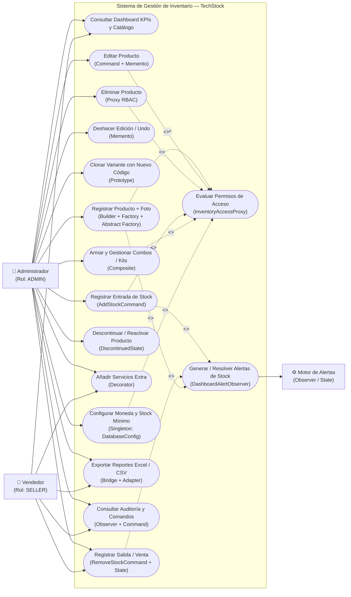

# Documentación Técnica de Patrones de Diseño GoF — TechStock

Este documento detalla la arquitectura Orientada a Objetos del sistema **TechStock**, el mapeo exacto de cada uno de los **15 Patrones de Diseño GoF** implementados en el código fuente, el **Diagrama UML de Clases** y el **Diagrama de Casos de Uso** en formato Mermaid.

---

## 1. Tabla de Implementación de los 15 Patrones GoF

### Patrones Creacionales (5)

| # | Patrón | Archivo(s) de Implementación | Clases / Interfaces Principales | Rol Real en el Flujo de la Aplicación |
| :-: | :--- | :--- | :--- | :--- |
| 1 | **Singleton** | `backend/src/patterns/creational/singleton/DatabaseConfig.ts` `backend/src/patterns/creational/singleton/InventoryStore.ts` | `DatabaseConfig` `InventoryStore` | Garantiza una única instancia para configuración global (moneda, símbolo, stock mínimo por defecto, nombre de tienda) y un único almacén/repositorio centralizado con persistencia JSON. |
| 2 | **Factory Method** | `backend/src/patterns/creational/factory-method/ProductFactory.ts` `backend/src/models/Product.ts` | `ProductFactory`, `LaptopFactory`, `PeripheralFactory`, `ComponentFactory`, `AccessoryFactory`, `ProductFactoryProvider` `Product`, `Laptop`, `Peripheral`, `Component`, `Accessory` | Delega en cada subclase fábrica la instanciación concreta por categoría, generando automáticamente prefijos de código (`LAP-`, `PER-`, `CMP-`, `ACC-`) y aplicando reglas de validación específicas por tipo de producto. |
| 3 | **Abstract Factory** | `backend/src/patterns/creational/abstract-factory/ProductLineFactory.ts` | `IProductLineFactory`, `GamerLineFactory`, `OfficeLineFactory`, `ProductLineFactoryProvider` `GamerSpecSheet`, `OfficeSpecSheet`, `GamerCodeLabel`, `OfficeCodeLabel` | Crea familias coherentes de artefactos según la gama comercial (`GAMER` vs `OFFICE`): Ficha Técnica (`ITechSpecSheet`) + Etiqueta de Código con barcode (`IProductCodeLabel`). |
| 4 | **Builder** | `backend/src/patterns/creational/builder/ProductBuilder.ts` | `ProductBuilder` `ProductDirector` | Construye paso a paso productos tecnológicos complejos (código, identidad, categoría, gama, precio, stock, especificaciones técnicas dinámicas, foto, proveedor y servicios) integrando `ProductFactory` y `DatabaseConfig`. |
| 5 | **Prototype** | `backend/src/patterns/creational/prototype/IPrototype.ts` `backend/src/models/Product.ts` | `IPrototype<T>`, `ProductPrototypeRegistry` `Product.clone()` (sobrescrito en `Laptop`, `Peripheral`, `Component`, `Accessory`) | Permite clonar profundamente un producto existente (especificaciones, foto, proveedor y servicios) para crear variantes rápidas con un nuevo código único desde el botón **Clonar**. |

### Patrones Estructurales (6)

| # | Patrón | Archivo(s) de Implementación | Clases / Interfaces Principales | Rol Real en el Flujo de la Aplicación |
| :-: | :--- | :--- | :--- | :--- |
| 6 | **Adapter** | `backend/src/patterns/structural/adapter/IReportExporter.ts` `backend/src/patterns/structural/adapter/ExcelExporterAdapter.ts` `backend/src/patterns/structural/adapter/CsvExporterAdapter.ts` | `IReportExporter` `ExcelExporterAdapter` `CsvExporterAdapter` | Adapta la librería externa `exceljs` (y la serialización CSV) a la interfaz propia `IReportExporter` del sistema, generando archivos `.xlsx` estilizados y `.csv` descargables. |
| 7 | **Facade** | `backend/src/patterns/structural/facade/InventoryFacade.ts` | `InventoryFacade` `DomainError` | Expone operaciones de alto nivel (`registerProduct`, `updateProduct`, `updateStock`, `cloneProduct`, `undoProductEdit`, `createKit`, `exportInventory`, etc.) orquestando todos los subsistemas creacionales, estructurales y de comportamiento. |
| 8 | **Decorator** | `backend/src/patterns/structural/decorator/ProductDecorator.ts` | `IProductPricingComponent`, `BaseProductPricing`, `ProductDecorator` `ExtendedWarrantyDecorator`, `SoftwareSetupDecorator`, `PrioritySupportDecorator`, `ProductDecoratorChain` | Envuelve dinámicamente un producto para añadir servicios extra (Garantía Extendida +12%, Instalación de Software +$35, Soporte VIP +$24.99) y recalcular el precio final y su desglose sin alterar la jerarquía `Product`. |
| 9 | **Composite** | `backend/src/patterns/structural/composite/InventoryItem.ts` | `InventoryItem` (abstracta) `SingleProduct` (Hoja) `ProductKit` (Compuesto) | Permite tratar productos individuales y combos/kits tecnológicos de manera uniforme para calcular precio total (con descuento de combo) y stock armable en tiempo real (`min(floor(stock / cantidad))`). |
| 10 | **Proxy** | `backend/src/patterns/structural/proxy/InventoryAccessProxy.ts` | `IInventoryService` `InventoryAccessProxy` `AccessDeniedError` | Actúa como Protection Proxy delante de `InventoryFacade` verificando el rol (`ADMIN` vs `SELLER`) antes de permitir operaciones sensibles (crear, editar, clonar, deshacer, descontinuar, eliminar, reabastecer, gestionar kits o config). |
| 11 | **Bridge** | `backend/src/patterns/structural/bridge/InventoryReport.ts` `backend/src/patterns/structural/bridge/ReportFormat.ts` | Abstracción: `InventoryReport`, `GeneralStockReport`, `LowStockReport`, `ValuedReport` Implementación: `IReportFormat`, `ExcelFormat`, `CsvFormat` | Desacopla el contenido de cada tipo de reporte (General, Stock Bajo, Valorizado) del formato de salida (Excel o CSV), permitiendo combinar las 6 variantes sin explosión de subclases. |

### Patrones de Comportamiento (4)

| # | Patrón | Archivo(s) de Implementación | Clases / Interfaces Principales | Rol Real en el Flujo de la Aplicación |
| :-: | :--- | :--- | :--- | :--- |
| 12 | **State** | `backend/src/patterns/behavioral/state/StockState.ts` | `IStockState`, `StockStateResolver` `AvailableState`, `LowStockState`, `OutOfStockState`, `DiscontinuedState` | Gestiona automáticamente transiciones de estado según `stock`, `minStock` e `isDiscontinued`, aplicando reglas de comportamiento (ej. bloquear salidas en `OutOfStockState` y bloquear cualquier movimiento en `DiscontinuedState`). |
| 13 | **Observer** | `backend/src/patterns/behavioral/observer/InventoryObserver.ts` | `IInventoryObserver`, `InventorySubject` `DashboardAlertObserver`, `AuditLogObserver` | Notifica automáticamente a los suscriptores ante cada evento de inventario: genera/resuelve alertas de stock bajo/agotado en el Dashboard y registra trazabilidad completa (incluidos bloqueos Proxy). |
| 14 | **Command** | `backend/src/patterns/behavioral/command/InventoryCommand.ts` | `IInventoryCommand`, `CommandInvoker` `AddStockCommand`, `RemoveStockCommand`, `UpdateProductCommand` | Encapsula entradas, salidas y ediciones de inventario como objetos comando ejecutables y mantiene un historial de auditoría estructurado de todas las ejecuciones. |
| 15 | **Memento** | `backend/src/patterns/behavioral/memento/ProductMemento.ts` | `ProductMemento` `ProductHistory` | Captura instantáneas inmutables del producto antes de editarlo o descontinuarlo, permitiendo ejecutar **Deshacer (Undo)** paso a paso desde la UI. |

---

## 2. Diagrama UML de Clases (Mermaid)

```mermaid
classDiagram
    direction TB

    %% --- PROXY & FACADE ---
    class IInventoryService {
        <<interface>>
        +registerProduct(actor, input) ProductDTO
        +updateProduct(actor, id, input) ProductDTO
        +updateStock(actor, id, input) ProductDTO
        +cloneProduct(actor, id, overrides) ProductDTO
        +undoProductEdit(actor, id) ProductDTO
        +createKit(actor, input) KitDTO
        +exportInventory(actor, type, format) ExportedFile
    }

    class InventoryAccessProxy {
        -realService: IInventoryService
        -subject: InventorySubject
        -assertAdmin(actor, action) void
    }

    class InventoryFacade {
        -store: InventoryStore
        -config: DatabaseConfig
        -subject: InventorySubject
        -commandInvoker: CommandInvoker
        -productHistory: ProductHistory
    }

    IInventoryService <|.. InventoryAccessProxy : implements
    IInventoryService <|.. InventoryFacade : implements
    InventoryAccessProxy o--> IInventoryService : delegates to

    %% --- SINGLETON ---
    class DatabaseConfig {
        <<Singleton>>
        -instance: DatabaseConfig
        -currency: string
        -defaultMinStock: number
        +getInstance() DatabaseConfig
        +updateConfig(updates) GlobalConfigData
    }

    class InventoryStore {
        <<Singleton>>
        -instance: InventoryStore
        -products: Map
        -kits: Map
        +prototypeRegistry: ProductPrototypeRegistry
        +getInstance() InventoryStore
        +saveProduct(product) void
        +persist() void
    }

    InventoryFacade --> DatabaseConfig
    InventoryFacade --> InventoryStore

    %% --- DOMAIN + PROTOTYPE + STATE + MEMENTO ---
    class IPrototype {
        <<interface>>
        +clone(overrides) Product
    }

    class Product {
        <<abstract>>
        +id: string
        +code: string
        +name: string
        +price: number
        +stock: number
        +minStock: number
        +services: ExtraServiceType[]
        #state: IStockState
        +specSheet: ITechSpecSheet
        +codeLabel: IProductCodeLabel
        +addStock(qty) void
        +removeStock(qty) void
        +createMemento(reason) ProductMemento
        +restoreFromMemento(memento) void
        +clone(overrides)* Product
    }

    class Laptop
    class Peripheral
    class Component
    class Accessory

    IPrototype <|.. Product
    Product <|-- Laptop
    Product <|-- Peripheral
    Product <|-- Component
    Product <|-- Accessory

    %% --- FACTORY METHOD & BUILDER & ABSTRACT FACTORY ---
    class ProductFactory {
        <<abstract>>
        +getCodePrefix()* string
        +generateNextCode(existingCodes) string
        +createProduct(params) Product
    }
    class LaptopFactory
    class PeripheralFactory
    class ComponentFactory
    class AccessoryFactory

    ProductFactory <|-- LaptopFactory
    ProductFactory <|-- PeripheralFactory
    ProductFactory <|-- ComponentFactory
    ProductFactory <|-- AccessoryFactory
    ProductFactory ..> Product : creates

    class ProductBuilder {
        +setCode(code) ProductBuilder
        +setBasicInfo(name, brand) ProductBuilder
        +setSpecifications(specs) ProductBuilder
        +setPhoto(imageUrl) ProductBuilder
        +build(existingCodes) Product
    }
    ProductBuilder ..> ProductFactory : uses
    InventoryFacade ..> ProductBuilder : orchestrates

    class IProductLineFactory {
        <<interface>>
        +createTechSpecSheet(name, cat, specs) ITechSpecSheet
        +createCodeLabel(code, name, cat) IProductCodeLabel
    }
    class GamerLineFactory
    class OfficeLineFactory
    IProductLineFactory <|.. GamerLineFactory
    IProductLineFactory <|.. OfficeLineFactory
    Product --> IProductLineFactory : builds line artifacts

    %% --- STATE ---
    class IStockState {
        <<interface>>
        +status: StockStatus
        +canAddStock() StockOperationCheck
        +canRemoveStock(stock, qty) StockOperationCheck
        +evaluateTransition(ctx) IStockState
    }
    class AvailableState
    class LowStockState
    class OutOfStockState
    class DiscontinuedState
    IStockState <|.. AvailableState
    IStockState <|.. LowStockState
    IStockState <|.. OutOfStockState
    IStockState <|.. DiscontinuedState
    Product o--> IStockState

    %% --- DECORATOR ---
    class IProductPricingComponent {
        <<interface>>
        +getPrice() number
        +getDescription() string
        +getServicesBreakdown() ServicePriceBreakdown[]
    }
    class BaseProductPricing
    class ProductDecorator {
        <<abstract>>
        #wrapped: IProductPricingComponent
    }
    class ExtendedWarrantyDecorator
    class SoftwareSetupDecorator
    class PrioritySupportDecorator

    IProductPricingComponent <|.. BaseProductPricing
    IProductPricingComponent <|.. ProductDecorator
    ProductDecorator o--> IProductPricingComponent
    ProductDecorator <|-- ExtendedWarrantyDecorator
    ProductDecorator <|-- SoftwareSetupDecorator
    ProductDecorator <|-- PrioritySupportDecorator

    %% --- COMPOSITE ---
    class InventoryItem {
        <<abstract>>
        +getPrice()* number
        +getAvailableStock()* number
        +isAvailable() boolean
    }
    class SingleProduct {
        -product: Product
    }
    class ProductKit {
        -children: KitChildEntry[]
        +discountPercent: number
        +add(item, qty) void
        +remove(itemId) void
    }
    InventoryItem <|-- SingleProduct
    InventoryItem <|-- ProductKit
    ProductKit o--> InventoryItem : composes
    SingleProduct --> Product : wraps

    %% --- BRIDGE + ADAPTER ---
    class InventoryReport {
        <<abstract>>
        #format: IReportFormat
        +generate(products, kits) ExportedFile
    }
    class GeneralStockReport
    class LowStockReport
    class ValuedReport
    InventoryReport <|-- GeneralStockReport
    InventoryReport <|-- LowStockReport
    InventoryReport <|-- ValuedReport

    class IReportFormat {
        <<interface>>
        +format(document) ExportedFile
    }
    class ExcelFormat
    class CsvFormat
    IReportFormat <|.. ExcelFormat
    IReportFormat <|.. CsvFormat
    InventoryReport o--> IReportFormat : bridge

    class IReportExporter {
        <<interface>>
        +export(document) ExportedFile
    }
    class ExcelExporterAdapter {
        +export(document) ExportedFile
    }
    class CsvExporterAdapter {
        +export(document) ExportedFile
    }
    IReportExporter <|.. ExcelExporterAdapter
    IReportExporter <|.. CsvExporterAdapter
    ExcelFormat --> ExcelExporterAdapter : uses adapter
    CsvFormat --> CsvExporterAdapter : uses adapter

    %% --- OBSERVER + COMMAND + MEMENTO ---
    class InventorySubject {
        -observers: IInventoryObserver[]
        +subscribe(observer) void
        +notify(event) void
    }
    class IInventoryObserver {
        <<interface>>
        +update(event) void
    }
    class DashboardAlertObserver
    class AuditLogObserver
    IInventoryObserver <|.. DashboardAlertObserver
    IInventoryObserver <|.. AuditLogObserver
    InventorySubject o--> IInventoryObserver
    InventoryFacade --> InventorySubject

    class IInventoryCommand {
        <<interface>>
        +execute() Result
        +getDescription() string
    }
    class AddStockCommand
    class RemoveStockCommand
    class UpdateProductCommand
    class CommandInvoker {
        +executeCommand(command) Result
    }
    IInventoryCommand <|.. AddStockCommand
    IInventoryCommand <|.. RemoveStockCommand
    IInventoryCommand <|.. UpdateProductCommand
    CommandInvoker ..> IInventoryCommand
    InventoryFacade --> CommandInvoker

    class ProductMemento {
        -snapshot: ProductSnapshot
        +getSnapshot() ProductSnapshot
    }
    class ProductHistory {
        -stacks: Map
        +push(memento) void
        +pop(productId) ProductMemento
    }
    ProductHistory o--> ProductMemento
    Product ..> ProductMemento : creates / restores
    InventoryFacade --> ProductHistory
```

---

## 3. Diagrama de Casos de Uso (Mermaid)

---

## 4. Flujo Integrado de Interacción entre Patrones

1. **Petición entrante HTTP → Proxy → Facade:** Cada ruta de `inventoryRoutes.ts` extrae `X-User-Role` y llama a `InventoryAccessProxy`. Si el rol es `SELLER` e intenta una mutación restringida, el Proxy dispara un evento `ACCESS_DENIED` hacia `InventorySubject` (registrado por `AuditLogObserver`) y responde `HTTP 403`.
2. **Creación de Producto:** `InventoryFacade.registerProduct()` usa `ProductDirector` + `ProductBuilder`, que invoca al `ProductFactory` concreto (Factory Method) para validar reglas y prefijos (`LAP-`, `PER-`, `CMP-`, `ACC-`), lee valores por defecto del Singleton `DatabaseConfig`, instancia la subclase `Product`, genera la ficha técnica y etiqueta coherente mediante `IProductLineFactory` (Abstract Factory), inicializa `IStockState` (State), persiste en el Singleton `InventoryStore` (registrándolo además en `ProductPrototypeRegistry`), y notifica a `DashboardAlertObserver` y `AuditLogObserver` (Observer).
3. **Edición y Deshacer:** `updateProduct()` captura un `ProductMemento` en `ProductHistory` antes de ejecutar `UpdateProductCommand` vía `CommandInvoker`. Cuando el usuario pulsa **Deshacer**, `undoProductEdit()` extrae el último `ProductMemento` y restaura el estado previo del producto, re-sincronizando `IStockState` y `Abstract Factory`.
4. **Movimientos de Stock:** `updateStock()` construye `AddStockCommand` o `RemoveStockCommand`. Antes de mutar, la entidad consulta `this.state.canAddStock()` / `canRemoveStock()`. Si el producto está en `OutOfStockState` o `DiscontinuedState`, el movimiento se rechaza con un error explícito. Si tiene éxito, `syncState()` transiciona automáticamente el estado y `DashboardAlertObserver` crea o resuelve alertas en vivo.
5. **Pricing Dinámico y Combos:** `ProductDecoratorChain` envuelve cada `Product` con sus decoradores activos (`ExtendedWarrantyDecorator`, `SoftwareSetupDecorator`, `PrioritySupportDecorator`). `SingleProduct` delega su precio a esta cadena decorada y `ProductKit` (Composite) agrega múltiples `SingleProduct` para calcular el precio total con descuento y el stock armable en vivo.
6. **Exportación de Reportes:** `InventoryFacade.exportInventory()` construye la abstracción Bridge (`GeneralStockReport`, `LowStockReport` o `ValuedReport`) inyectando la implementación de formato (`ExcelFormat` o `CsvFormat`), que a su vez delega la generación binaria a `ExcelExporterAdapter` (`exceljs`) o `CsvExporterAdapter` mediante la interfaz `IReportExporter` (Adapter).
