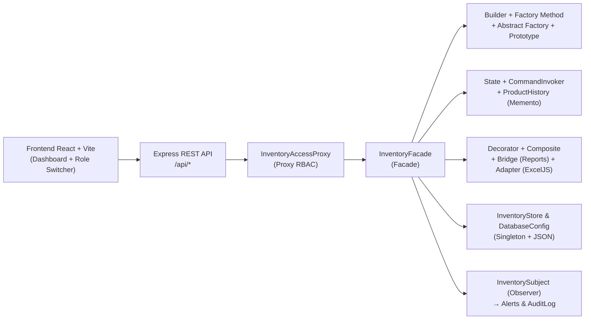

<div align="center">

# TechStock

### Sistema Full-Stack de Gestión de Inventario Tecnológico con 15 Patrones de Diseño GoF


[Características](#características-principales) · [15 Patrones GoF](#15-patrones-de-diseño-gof) · [Arquitectura](#arquitectura-general) · [Inicio Rápido](#inicio-rápido) · [Guía de Demo](#guía-para-probar-los-15-patrones-en-la-ui) · [API REST](#api-rest) · [Diagramas UML](./PATTERNS.md)

</div>

---

## Descripción General

**TechStock** es una aplicación **Full-Stack Orientada a Objetos** para la gestión integral del inventario de una tienda tecnológica (*Laptops, Periféricos, Componentes y Accesorios*).

A diferencia de ejemplos aislados, los **15 Patrones de Diseño Gang of Four (GoF)** están implementados en TypeScript con POO estricta (clases abstractas, interfaces y encapsulación) y **conectados al flujo real** del Backend y del Dashboard en React, permitiendo comprobar cada patrón de forma visual e interactiva.

---

## Características Principales

- **Dashboard de Stock en Tiempo Real:** KPIs automáticos (total de productos y unidades, valorización del inventario con servicios extra, stock bajo y agotados), filtros avanzados y vista en **Tarjetas** o **Tabla**.
- **Panel de Alertas Automáticas:** Notificaciones en vivo cuando un producto cae por debajo del stock mínimo o queda agotado, con reposición rápida en un clic (*Observer*).
- **Registro de Productos con Foto:** Código único con prefijo automático por categoría (`LAP-`, `PER-`, `CMP-`, `ACC-`), especificaciones técnicas dinámicas, vista previa de ficha técnica y etiqueta por gama (*Gamer* vs. *Oficina*), y carga de foto mediante **archivo local** (`PNG/JPG/WEBP/GIF`) o **URL**.
- **Gestión Avanzada de Inventario:**
  - Entradas y salidas de stock con reglas de transición automática (*Disponible → Stock Bajo → Agotado / Descontinuado*) e historial de comandos.
  - **Clonar producto** para crear variantes rápidas con un nuevo código (*Prototype*).
  - **Deshacer cambios (Undo)** al editar productos restaurando instantáneas previas (*Memento*).
  - **Combos / Kits Tecnológicos** con cálculo dinámico de precio con descuento y stock armable en tiempo real (*Composite*).
  - **Servicios Extra** (Garantía Extendida 24m, Instalación de Software, Soporte VIP) con recálculo dinámico (*Decorator*).
- **Exportación Real a Excel y CSV:** Descarga directa desde el Frontend de reportes **General**, **Stock Bajo** y **Valorizado** en **`.xlsx`** (con estilos, formato de moneda, autofiltro y resumen) y **`.csv`** (*Bridge + Adapter*).
- **Control de Roles (Admin vs. Vendedor):** Selector de rol en la barra superior que activa el bloqueo de operaciones sensibles (`HTTP 403`) y registra el intento en auditoría (*Proxy*).

---

## 15 Patrones de Diseño GoF

> Consulta la documentación técnica completa, el **Diagrama UML de Clases** y el **Diagrama de Casos de Uso** en [**PATTERNS.md**](./PATTERNS.md).

| Categoría | # | Patrón | Implementación Principal | Función en TechStock |
| :--- | :-: | :--- | :--- | :--- |
| **Creacionales (5)** | 1 | **Singleton** | [`DatabaseConfig.ts`](./backend/src/patterns/creational/singleton/DatabaseConfig.ts) · [`InventoryStore.ts`](./backend/src/patterns/creational/singleton/InventoryStore.ts) | Configuración global única (moneda, stock mínimo) y repositorio centralizado con persistencia JSON. |
| | 2 | **Factory Method** | [`ProductFactory.ts`](./backend/src/patterns/creational/factory-method/ProductFactory.ts) | Instancia `Laptop`, `Peripheral`, `Component` y `Accessory` con prefijos y validaciones propias. |
| | 3 | **Abstract Factory** | [`ProductLineFactory.ts`](./backend/src/patterns/creational/abstract-factory/ProductLineFactory.ts) | Genera familias coherentes (`GamerLineFactory` vs. `OfficeLineFactory`): Ficha Técnica + Etiqueta de Código. |
| | 4 | **Builder** | [`ProductBuilder.ts`](./backend/src/patterns/creational/builder/ProductBuilder.ts) | Construye paso a paso productos complejos (código, specs, foto, stock, proveedor, extras). |
| | 5 | **Prototype** | [`IPrototype.ts`](./backend/src/patterns/creational/prototype/IPrototype.ts) · [`Product.ts`](./backend/src/models/Product.ts) | Clona un registro existente (`clone()`) para crear variantes con un nuevo código único. |
| **Estructurales (6)** | 6 | **Adapter** | [`ExcelExporterAdapter.ts`](./backend/src/patterns/structural/adapter/ExcelExporterAdapter.ts) · [`CsvExporterAdapter.ts`](./backend/src/patterns/structural/adapter/CsvExporterAdapter.ts) | Adapta `exceljs` y la exportación CSV a la interfaz propia `IReportExporter`. |
| | 7 | **Facade** | [`InventoryFacade.ts`](./backend/src/patterns/structural/facade/InventoryFacade.ts) | Orquesta creación, edición, movimientos de stock, kits, deshacer, alertas y reportes. |
| | 8 | **Decorator** | [`ProductDecorator.ts`](./backend/src/patterns/structural/decorator/ProductDecorator.ts) | Añade dinámicamente Garantía Extendida, Instalación de Software y Soporte VIP al precio. |
| | 9 | **Composite** | [`InventoryItem.ts`](./backend/src/patterns/structural/composite/InventoryItem.ts) | Unifica `SingleProduct` y `ProductKit` para calcular precio con descuento y stock disponible. |
| | 10 | **Proxy** | [`InventoryAccessProxy.ts`](./backend/src/patterns/structural/proxy/InventoryAccessProxy.ts) | Controla permisos RBAC (`ADMIN` vs. `SELLER`) antes de ejecutar operaciones sensibles. |
| | 11 | **Bridge** | [`InventoryReport.ts`](./backend/src/patterns/structural/bridge/InventoryReport.ts) · [`ReportFormat.ts`](./backend/src/patterns/structural/bridge/ReportFormat.ts) | Separa el tipo de reporte (`General`, `LowStock`, `Valued`) del formato (`Excel`, `CSV`). |
| **Comportamiento (4)** | 12 | **State** | [`StockState.ts`](./backend/src/patterns/behavioral/state/StockState.ts) | Gestiona `AvailableState`, `LowStockState`, `OutOfStockState` y `DiscontinuedState` con reglas automáticas. |
| | 13 | **Observer** | [`InventoryObserver.ts`](./backend/src/patterns/behavioral/observer/InventoryObserver.ts) | `DashboardAlertObserver` (alertas en vivo) y `AuditLogObserver` (bitácora de eventos). |
| | 14 | **Command** | [`InventoryCommand.ts`](./backend/src/patterns/behavioral/command/InventoryCommand.ts) | Encapsula `AddStockCommand`, `RemoveStockCommand` y `UpdateProductCommand` con `CommandInvoker`. |
| | 15 | **Memento** | [`ProductMemento.ts`](./backend/src/patterns/behavioral/memento/ProductMemento.ts) | Guarda instantáneas (`ProductHistory`) antes de editar para habilitar **Deshacer (Undo)**. |

---

## Arquitectura General



---

## Stack Tecnológico

| Capa | Tecnologías |
| :--- | :--- |
| **Backend** | Node.js, TypeScript 5.7, Express 4, Multer 2, ExcelJS 4, CORS, Persistencia JSON |
| **Frontend** | React 18, TypeScript, Vite 6, TailwindCSS 3, Lucide Icons |
| **Documentación** | Markdown, Diagramas UML de Clases y Casos de Uso en Mermaid |

---

## Estructura del Monorepo

```text
.
├── package.json                       # Scripts globales del monorepo
├── .gitignore                         # Protección contra subida de secretos, .env y binarios locales
├── README.md                          # Guía principal del proyecto
├── PATTERNS.md                        # Tabla técnica de 15 patrones y diagramas UML Mermaid
├── backend/
│   ├── .env.example                   # Plantilla de variables de entorno (sin credenciales)
│   ├── package.json
│   ├── tsconfig.json
│   ├── public/images/                 # Ilustraciones SVG locales para el catálogo inicial
│   ├── uploads/                       # Imágenes subidas en ejecución (ignoradas por Git)
│   └── src/
│       ├── app.ts                     # Configuración Express, seguridad y ensamblaje GoF
│       ├── server.ts                  # Arranque HTTP (puerto 3001)
│       ├── models/                    # Product.ts (jerarquía POO) y types.ts
│       ├── patterns/
│       │   ├── creational/            # singleton, factory-method, abstract-factory, builder, prototype
│       │   ├── structural/            # adapter, bridge, composite, decorator, facade, proxy
│       │   └── behavioral/            # command, memento, observer, state
│       ├── routes/inventoryRoutes.ts  # Endpoints REST
│       ├── seed/seedData.ts           # 8 productos tecnológicos + 1 Combo Gamer
│       └── utils/upload.ts            # Carga segura de imágenes raster con Multer 2
└── frontend/
    ├── package.json
    ├── vite.config.ts                 # Proxy hacia http://localhost:3001
    └── src/
        ├── App.tsx                    # Layout principal, navegación y estado global
        ├── api/client.ts              # Cliente REST tipado
        ├── types/inventory.ts
        └── components/                # KPIs, Alertas, Tarjetas/Tabla, Modales, Kits, Auditoría y Exportación
```

---

## Inicio Rápido

### Requisitos Previos
- **Node.js 18 o superior** y **npm 9+**.

### 1. Clonar e instalar dependencias

```bash
git clone <URL_DE_TU_REPOSITORIO>
cd <CARPETA_DEL_PROYECTO>
npm run install:all
```

### 2. Ejecutar en modo desarrollo

Abre **dos terminales** en la raíz del proyecto:

```bash
# Terminal 1 — Backend API (http://localhost:3001)
npm run dev:backend
```

```bash
# Terminal 2 — Frontend Dashboard (http://localhost:5173)
npm run dev:frontend
```

Abre **[http://localhost:5173](http://localhost:5173)** en tu navegador. El catálogo semilla se carga automáticamente en el primer arranque.

### 3. Compilar para producción

```bash
npm run build
```

### Variables de Entorno (Opcionales)

Consulta [`backend/.env.example`](./backend/.env.example). No se requiere ninguna clave ni token externo para ejecutar el sistema:

| Variable | Valor por defecto | Descripción |
| :--- | :--- | :--- |
| `PORT` | `3001` | Puerto HTTP del Backend |
| `CORS_ORIGINS` | `http://localhost:5173,http://127.0.0.1:5173` | Orígenes permitidos separados por coma |

---

## Datos Semilla Iniciales (Seed)

Al iniciar por primera vez (o mediante el botón **Restaurar Datos Semilla** en *15 Patrones & Config*), TechStock incluye **8 productos tecnológicos** y **1 Combo Gamer**:

| Código | Producto | Categoría | Gama | Precio Base | Stock / Mín. | Estado Inicial |
| :--- | :--- | :--- | :--- | ---: | :---: | :--- |
| `LAP-001` | ASUS ROG Strix G16 (2025) | Laptop | Gamer | $1,699.00 | 8 / 3 | Disponible *(+Garantía 24m)* |
| `LAP-002` | Lenovo ThinkPad X1 Carbon Gen 12 | Laptop | Oficina | $1,549.00 | 2 / 4 | **Stock Bajo** *(+Inst. Software)* |
| `PER-001` | Logitech G Pro X Superlight 2 | Periférico | Gamer | $159.00 | 14 / 5 | Disponible |
| `PER-002` | Keychron K8 Pro Mecánico RGB | Periférico | Gamer | $129.00 | 3 / 5 | **Stock Bajo** |
| `PER-003` | Dell UltraSharp 27" 4K USB-C Hub | Periférico | Oficina | $629.00 | 6 / 3 | Disponible |
| `CMP-001` | NVIDIA GeForce RTX 4070 Ti Super 16GB | Componente | Gamer | $849.00 | 0 / 3 | **Agotado** |
| `CMP-002` | Samsung 990 PRO NVMe M.2 2TB | Componente | Oficina | $179.00 | 12 / 4 | Disponible |
| `ACC-001` | HyperX Cloud III Wireless DTS:X | Accesorio | Gamer | $169.00 | 9 / 3 | Disponible |

- **Combo Gamer (`KIT-001` — Combo Pro Gamer Ultimate):** Agrupa `LAP-001` + `PER-001` + `PER-002` + `ACC-001` con **10% de descuento** y stock armable dinámico inicial de **3 combos**.

---

## Guía para Probar los 15 Patrones en la UI

1. **Singleton:** Abre **15 Patrones & Config**, cambia la moneda (`USD` → `PEN`) o el stock mínimo por defecto y guarda; toda la UI y los reportes adoptan la configuración al instante.
2. **Builder + Factory Method + Abstract Factory:** Pulsa **+ Nuevo Producto**. Al cambiar la categoría se genera el prefijo (`LAP-`, `PER-`, `CMP-`, `ACC-`); al alternar entre **Gamer** y **Oficina** se actualiza en vivo la Ficha Técnica y Etiqueta de Código.
3. **Prototype:** En cualquier tarjeta pulsa **Clonar**, revisa el código sugerido y crea una variante conservando especificaciones y foto.
4. **Decorator:** Pulsa **Servicios** en un producto y activa *Garantía Extendida* o *Instalación de Software* para ver el recálculo en cadena del precio.
5. **Composite:** En **Combos / Kits** revisa `KIT-001` o arma un nuevo kit. Si descuentas unidades de `PER-002` en el Dashboard, el stock armable del combo se recalcula automáticamente.
6. **State + Command + Observer:** En `CMP-001` (*Agotado*) pulsa **Stock +/-** e intenta registrar una salida: `OutOfStockState` bloqueará la operación. Al descontar stock de otro producto hasta bajar del mínimo, aparecerá una alerta automática en el Dashboard y el comando quedará registrado en **Auditoría & Comandos**.
7. **Memento (Undo):** Pulsa **Editar** en cualquier producto, modifica su nombre o precio y guarda. Luego haz clic en **Deshacer (1)** para restaurar el estado exacto anterior.
8. **Proxy (RBAC):** Cambia el rol superior de **Admin** a **Vendedor** e intenta crear, editar, clonar, reabastecer o eliminar un producto: `InventoryAccessProxy` devolverá `HTTP 403` y registrará `ACCESS_DENIED` en auditoría, permitiendo únicamente consultar, registrar ventas (`OUT`), cotizar extras y exportar.
9. **Bridge + Adapter:** Pulsa **Exportar Excel/CSV**, combina cualquiera de los 3 tipos de reporte con `.xlsx` o `.csv` y descarga el archivo real.

---

## API REST

<details>
<summary><strong>Ver tabla completa de endpoints (<code>/api/*</code>)</strong></summary>

> Todos los endpoints evalúan la cabecera `X-User-Role: ADMIN | SELLER` mediante `InventoryAccessProxy`. Por principio de mínimo privilegio (*fail-closed*), si la cabecera se omite el rol asumido es `SELLER`.

| Método | Endpoint | Rol Requerido | Descripción y Patrones |
| :--- | :--- | :--- | :--- |
| `GET` | `/api/health` | Todos | Estado del servidor API |
| `GET` | `/api/dashboard` | Todos | KPIs, distribución por categoría y métricas de patrones (**Facade + Singleton**) |
| `GET` | `/api/products` | Todos | Catálogo completo con estado (**State**), extras (**Decorator**) y ficha/etiqueta (**Abstract Factory**) |
| `POST` | `/api/products` | **Admin** | Registra producto (**Proxy + Facade + Builder + Factory Method + Abstract Factory + Observer**) |
| `PUT` | `/api/products/:id` | **Admin** | Edita producto guardando snapshot (**Proxy + Memento + Command + Observer**) |
| `DELETE` | `/api/products/:id` | **Admin** | Elimina producto (**Proxy + Facade + Observer**) |
| `POST` | `/api/products/:id/stock` | Admin (`IN`) / Todos (`OUT`) | Entrada o salida validada por estado (**Proxy + State + Command + Observer**) |
| `PATCH` | `/api/products/:id/discontinue` | **Admin** | Marca como descontinuado o reactiva (**Proxy + State + Memento**) |
| `POST` | `/api/products/:id/clone` | **Admin** | Clona producto con nuevo código (**Prototype + Factory Method**) |
| `GET` | `/api/products/:id/history` | Todos | Lista instantáneas de edición (**Memento**) |
| `POST` | `/api/products/:id/undo` | **Admin** | Revierte la última edición (**Memento**) |
| `POST` | `/api/products/:id/services` | Todos | Añade servicio extra (**Decorator**) |
| `DELETE` | `/api/products/:id/services/:service` | **Admin** | Retira servicio extra (**Decorator + Proxy**) |
| `POST` | `/api/uploads` | **Admin** | Carga imagen (`PNG`, `JPG`, `WEBP`, `GIF`, máx. 5 MB) |
| `GET` | `/api/kits` | Todos | Lista combos con precio y stock calculado (**Composite**) |
| `POST` | `/api/kits` | **Admin** | Crea nuevo Combo / Kit (**Composite + Proxy**) |
| `DELETE` | `/api/kits/:id` | **Admin** | Elimina Combo / Kit (**Composite + Proxy**) |
| `GET` | `/api/alerts` | Todos | Alertas activas (**Observer: `DashboardAlertObserver`**) |
| `GET` | `/api/audit/logs` | Todos | Bitácora de auditoría (**Observer: `AuditLogObserver`**) |
| `GET` | `/api/audit/commands` | Todos | Historial de comandos (**Command: `CommandInvoker`**) |
| `GET` | `/api/reports/export?type=general\|low-stock\|valued&format=excel\|csv` | Todos | Exporta archivo real `.xlsx` o `.csv` (**Bridge + Adapter**) |
| `GET` / `PUT` | `/api/config` | Todos / **Admin** | Consulta o modifica configuración global (**Singleton: `DatabaseConfig`**) |
| `POST` | `/api/admin/reset-seed` | **Admin** | Restaura el catálogo semilla inicial |

</details>

---

## Seguridad y Buenas Prácticas

- **Sin credenciales ni secretos en el repositorio:** No existen llaves API, tokens ni archivos `.env` versionados; `.gitignore` bloquea secretos y datos de ejecución.
- **0 vulnerabilidades en dependencias:** `npm audit` limpio en `backend` y `frontend` (`multer` v2 y `crypto.randomUUID()` nativo).
- **Control de acceso Fail-Closed:** La ausencia de cabecera de rol nunca eleva privilegios a `ADMIN`.
- **Protección contra XSS e inyección:** Subida restringida a imágenes raster con nombres UUID y cabeceras `CSP sandbox` + `X-Content-Type-Options: nosniff`, validación estricta de URLs de imagen (`http/https` o rutas locales), CORS restringido por origen y saneamiento contra *CSV Formula Injection*.

---

## Documentación Adicional

- [**PATTERNS.md**](./PATTERNS.md): Tabla exacta de archivos y clases de los 15 patrones, **Diagrama UML de Clases** y **Diagrama de Casos de Uso** en Mermaid.
